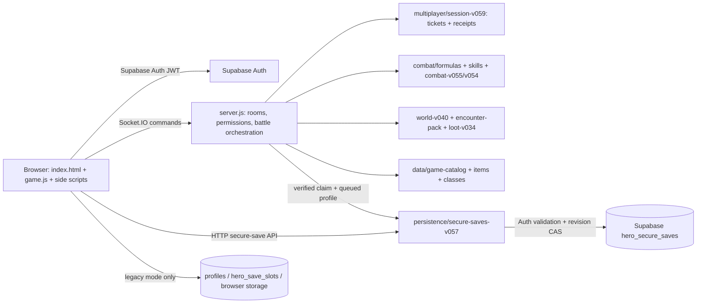

# SOULBOUND Online: Repository audit และแผน refactor

วันที่ตรวจ: 2026-11-15 · ฐาน: `v0.62-foundation-single-source` ที่ commit `4ad15a7830bc9925f7ee91a1b7ca2ebd3c16f56d`

## ขอบเขตและฐานที่ใช้

`main` ที่ `add5042380efa2172985ab71c7cdcb3ed6100b08` ยังเป็น prototype ขนาดเล็ก ไม่มี Supabase/Login/Save/Shop จึงไม่ใช่ฐานที่ตรงกับงานนี้ พบ branch พัฒนาแยกหลายรุ่น และเลือก foundation รุ่น 0.62 ที่มีระบบเหล่านี้ครบเป็นฐานของ PR นี้ ไม่รวม feature branches เข้ากับ main และไม่ถือว่า branch นี้คือ production ที่ยืนยันแล้ว

ตรวจรายการไฟล์ทั้ง tree (370 ไฟล์), source/config/test/SQL/docs ที่เป็นข้อความ 250 ไฟล์ และเส้นทางอ้างอิง assets; ตรวจเชิงลึกระบบ runtime ด้านล่าง ไม่ใช่การรับรองคุณภาพภาพ/เสียงหรือว่าไม่มีบั๊กเหลืออยู่ รัน baseline จาก clone ต้นฉบับแยกจากแพตช์ ใช้การทดสอบ local และ mocks สำหรับ Supabase ไม่อ่านข้อมูลผู้เล่นจริง ไม่ใช้ service secret ไม่รัน SQL ไม่แก้ schema/รูปแบบเซฟ ไม่ deploy และไม่ merge

## สถาปัตยกรรมปัจจุบัน

| ส่วน | หน้าที่และสถานะ |
| --- | --- |
| `server.js` | Express/static/health/index/save routes, Socket.IO handlers, room Map, player factory/restore, permission checks, combat action executor, enemy scheduler, rewards, shop และ progression ยังรวมกัน |
| `multiplayer/session-v059.js` | ticket สุ่ม 256 บิต, grace 120 วินาทีหลัง disconnect, ticket rotation และ action receipts จำกัด 512 รายการ; เก็บใน process เดียว |
| `combat/formulas.js`, `combat/skills.js` | สูตร damage และ executable skill definitions เป็นโมดูลแล้ว |
| `combat-v055.js`, `combat-v054.js`, `elemental-v0552.js` | status/DOT, guard, interrupt, boss phases และ elemental relations; v055 ใช้ฐาน v054 จึงยังลบ v054 ไม่ได้ |
| `world-v040.js`, `encounter-pack-v0562.js` | 8 regions / 40 stages, level gates, boss clears และการสร้าง enemy pack ตามขนาด party |
| `data/game-catalog-v062.js`, `api/adventure-index-v062.js`, `items/*`, `classes/*` | catalog กลางสำหรับ monster/shop/race/Archer และ read-only INDEX; งาน single-source ก่อนหน้านี้ทำไว้แล้ว ควรรักษาไว้ |
| `loot-v034.js` | canonical item reconstruction, UID, rarity, drops, 9 equipment slots, bag capacity และ equip/unequip |
| `persistence/secure-saves-v057.js` | ตรวจ JWT กับ Supabase Auth, owner-specific slots 1–3, server-only writes, revision compare-and-swap และ queue ต่อ slot |
| `public/game.js` | auth, save slots, profile codecs, lobby/RPC/reconnect, battle commands และ renderer รวมในไฟล์เดียว; script แบบ classic ไม่ใช้ bundler |
| `public/*` UI scripts | equipment modal, INDEX, world UI, i18n, audio, animation, tooltips/rewards; ใช้ `window.Soulbound*` facade และ DOM hooks ร่วมกัน |
| CSS | มี versioned files จำนวนมากและ generated bundles; ตรวจ script/style tags ก่อนลบ เพราะไฟล์เก่าอาจเป็น input ของ bundle |
| Deployment/tests | `render.yaml` เรียก npm install/start; ไม่มี lockfile ในฐาน; tests ใช้ Node assertions, DOM/Socket.IO mocks, parity tests และ source-string checks ผสมกัน |

### การไหลของ Login และ Save ที่ต้องรักษา

1. Browser login ด้วย Supabase Auth แล้วรับ access token; public/publishable key ใน browser เป็นค่าที่เปิดเผยได้ ไม่พบ server secret ใน source ที่ตรวจ
2. Secure mode เปิดเฉพาะเมื่อ server มี URL, publishable key และ secret ครบ; `/health` บอก `secureSavesEnabled` และ client ตรวจ mode ก่อนเลือกเส้นทาง
3. Account restore ใน secure mode โหลด JSON ของเจ้าของ slot ผ่าน server แล้ว register claim; ไม่รับตัวเลข level/gold จาก browser เป็นข้อมูลจริง ส่วน guest/legacy ยังเชื่อ browser ตามข้อจำกัดเดิม
4. `emit()` เรียก persist สำหรับ verified heroes; queue deduplicate profile ที่เหมือนเดิม และ PATCH ด้วย revision CAS
5. Legacy Slot 1 อยู่ `profiles`; Slots 2–3 อยู่ `hero_save_slots`; guest ใช้ localStorage; world cache/backup มี key ตาม owner และ slot
6. SQL secure-save เดิมสร้าง `hero_secure_saves` และ import legacy โดยไม่ลบตารางเก่า แต่ไม่ได้ sync สองระบบต่อเนื่อง การสลับ mode กลับไป legacy อาจแสดง progress เก่า ต้องไม่เปิด/ปิด mode หรือรัน migration โดยไม่วางแผนและได้รับอนุญาต

## ข้อค้นพบเรียงตามผลกระทบ

ตำแหน่งอ้างอิงเป็น **ฐาน commit ก่อนแพตช์** บางบรรทัดใน PR จะเลื่อน:

| ระดับ | หลักฐาน/ผลกระทบ | สถานะ |
| --- | --- | --- |
| สูง | `server.js:103–104` destructuring `null` โยน TypeError และ callback ที่ส่งผิดชนิดเรียกไม่ได้; async rejection ก็ไม่มี boundary กลาง | แก้ในชุดนี้ด้วย `multiplayer/socket-boundary.js`; payload ที่ละไว้ยังใช้ `{}` ได้ |
| สูง | `server.js:103–104,316` socket เดียว create/join ได้หลายห้อง แต่ findRoom/disconnect เลือกห้องแรก ทำให้สมาชิก/สิทธิ์/claim ไม่ตรงกัน; code ชนกันทับห้องเดิมได้ | แก้ one-room guard, collision retry และ crypto base36 code ความยาวเดิม |
| สูง | `server.js:105–123` resume รอ authenticate แล้ว socket สร้างห้องอื่นหรือหลุดระหว่างรอได้ ทำให้หลายห้องหรือ ghost player | แก้ in-flight guard, ตรวจ disconnect หลัง await และคืน guard ใน finally |
| สูง | `server.js:124–151` verified hero restore slot อื่นซ้ำได้ ทำให้ claim เดิมค้างและ slot ถูกล็อกจน restart | ปฏิเสธ repeated verified restore; ไม่เปลี่ยน queue/codec/schema |
| สูง | `persistence/secure-saves-v057.js:92–115` queued profile เก็บ reference ของ inventory/food/world แต่ scalar เช่น gold ถูก copy ไปแล้ว; ยืนยันด้วย fake fetch: enqueue gold=100/bag=[], เปลี่ยนเป็น gold=0/bag=[paidItem], PATCH กลับเป็น gold=100/bag=[paidItem] | ยังไม่แก้ ต้องเสนอ deep snapshot ของ JSON เดิมตอน enqueue และทดสอบ crash consistency แยกชุด; เป็นการเปลี่ยนพฤติกรรมระบบเซฟจึงรออนุญาต |
| สูง | `persistence/secure-saves-v057.js:114–116`, `server.js:19` save error ส่ง warning แต่ gameplay เดินต่อ; PATCH สำเร็จแต่ response timeout อาจทำให้ local revision เก่าและเซฟครั้งถัดไป conflict ตลอด | ยังไม่แก้ ต้องกำหนด pause/recovery policy และอนุญาตก่อนเปลี่ยนระบบเซฟ |
| สูง | `server.js:85` sort players Map ตาม speed แต่ leader checks ใช้ key แรก เช่น `:161,:179`; Archer ที่เร็วกว่า founder ได้ leader privileges หลัง start | ยังไม่แก้ ยืนยันด้วย harness; แยก leaderId จาก turn order ใน PR ถัดไป |
| สูง | `server.js:159–168` travelRegion เริ่ม battle ได้โดยไม่ตรวจ verified restore/missing members เหมือน startBattle ที่ `:179` | ยังไม่แก้ รวม readiness guard ทุก entry point ใน PR ต่อสู้ถัดไป |
| กลาง | `server.js:9–16` active-claim check ของ delete/new game ไม่ atomic กับ await ที่ตามมา จึงแข่งกับ restore ได้; CAS กัน stale overwrite แต่ session อาจเล่นต่อแล้วเซฟไม่ได้ | ยังไม่แก้ วาง per-slot operation reservation หลังอนุญาตงานเซฟ |
| กลาง | `public/game.js:278` join ไม่เก็บ ticket; `:155–160` client นับหมดอายุจากเวลาสร้าง ticket แทน disconnect จึงเล่นเกิน 2 นาทีแล้ว reconnect ไม่ได้ | แก้เก็บ JOIN ticket และให้ server ตรวจ expiry; storage key/ticket format เดิม |
| กลาง | `server.js:25,156,309` rollRace clamp HP ขั้นต่ำ 1 และ allocate vitality เพิ่ม HP แม้ตายระหว่าง battle; ยังไม่มี state gate ของ progression | ยังไม่แก้ ต้องยืนยันกติกา progression ระหว่าง combat ก่อน |
| กลาง | `server.js:253–254` stagger allowlist ขาด skill6/skill7 ทั้งที่ Codex บอก damaging skills สร้าง Stagger | ยังไม่แก้ เพิ่ม parity/behavior tests แล้วแก้เฉพาะ allowlist หลัง review |
| กลาง | `public/i18n-v038.js:263,266,282–283` walk เขียน button.textContent ทุกครั้ง; observer เห็น childList ของตัวเองแล้ว schedule full-body walk ต่อทุก frame | ยังไม่แก้ เสนอเขียนใหม่เฉพาะ translation observer loop พร้อม equality guard/dirty subtree |
| กลาง | `public/i18n-v038.js:234,245,271` Set เก็บ text nodes ที่ถูกถอดจาก DOM จนกว่าจะสลับภาษา | ยังไม่แก้ cleanup disconnected nodes ระหว่าง flush |
| กลาง | `public/game.js:146,331` RPC ไม่มี timeout/disconnected check; action buttons อาจยังเปิดและ Socket.IO buffer คำสั่งระหว่างหลุด | ยังไม่แก้ รวมใน transport extraction พร้อม pending-request tests |
| กลาง | ยังไม่มี rate limit/cap จำนวน socket/rooms/คำสั่ง; receipt IDs ยัง optional; guest/legacy สามารถส่งค่าตัวละครเองได้ | boundary ชุดนี้ไม่ใช่ anti-abuse หรือ competitive-economy hardening |
| กลาง | dependency ไม่มี lockfile; Supabase CDN ใช้ floating `@2`; tests บางส่วนตรวจแค่ข้อความใน source | แยก reproducible build/dependency review; ไม่อัปเกรด dependencies ในแพตช์นี้ |

ความปลอดภัยของ Supabase ที่ตรวจได้เป็น **source เท่านั้น**: SQL ระบุ secure table ให้ service_role เขียนและ revoke browser permissions แต่ไม่ได้ยืนยัน RLS/grants/env ที่ติดตั้งจริง ห้ามถือว่าระบบ deployed อยู่ secure mode จากชื่อ branch เพียงอย่างเดียว

### Inventory, Shop และ Progression

`loot-v034.js:77–103,147–185` reconstruct item stats จาก catalog/ID, รักษา UID/slot, เก็บกระเป๋าเก่าที่เกิน 40 ชิ้นไว้ และ block การเพิ่ม/unequip ที่ทำให้เกิน capacity; server ตรวจ ownership/class/level/price/category และ weapon boss gate ก่อนซื้อ ไม่มีเหตุผลให้เขียนระบบกระเป๋าใหม่

Progression ให้ XP/gold, level/stat points, race points และ boss/world clears ฝั่ง server; `finish()` มี encounter marker กัน reward ซ้ำใน process เดิม จุดที่ต้องแก้คือ transition/permission และความสอดคล้อง snapshot ไม่ใช่เปลี่ยนตารางรางวัลหรือ balance ทั้งเกม

### โค้ดซ้ำและประสิทธิภาพ

- `public/game.js` มี `profile()`/`saveProfile()` ที่ map fields คล้ายกัน และ fresh-character defaults ซ้ำกับ `server.js`/secure starter; เสี่ยง field หายเมื่อเพิ่มคลาส แต่ยังห้ามเปลี่ยน wire/save keys
- `findRoom()` สร้าง array และ scan ทุก room ทุก event; ใช้ socket-to-room index หลัง one-room invariant มี tests แล้ว
- `publicRoom()` ส่ง shop catalog/skill books/inventory/log ทั้งชุด และ `render()` เขียนหลาย innerHTML ทุก state รวม chat; ทำให้ DOM churn และ animation reset
- `emit()` serialize verified profile ทุกครั้ง แม้ queue จะ deduplicate จึง **ไม่ได้เขียน DB ทุก chat เสมอไป**; แยก publish state จาก persist-on-player-mutation ภายหลัง
- `/api/index` rebuild ข้อมูลจาก catalog ที่ไม่เปลี่ยนทุก request; cache immutable projection ภายใน process ได้หลังมี parity checks
- pending enemy ใช้ timers และ polling ระหว่าง reconnect; room/session/reward receipts ไม่คงอยู่เมื่อ process restart และไม่รองรับหลาย instance
- CSS version layers และ global side scripts มี coupling; อย่าลบไฟล์เก่าจากชื่ออย่างเดียว ต้องตรวจ runtime tags, bundle script และ fallback ก่อน

## แผน refactor ทีละ PR

| ลำดับ | ขอบเขต | เงื่อนไขผ่านก่อนรวม |
| --- | --- | --- |
| 1 (PR นี้) | แยก socket transport boundary; ป้องกัน session ซ้อน/claim ซ้ำ; แก้ ticket lifecycle ฝั่ง browser | malformed commands, collision, reconnect/restore races และ old suite ผ่าน; SQL/codec untouched |
| 2 | `server/rooms.js` + `server/session-controller.js`: room index, leaderId, create/join/resume/disconnect | founder ไม่เปลี่ยนตาม speed; disconnect leader policy ชัดเจน; 1–4 players และ reconnect preserve turn |
| 3 | `server/battle-controller.js` + scheduler: รวม start/travel readiness, execute action, enemy beat และ rewards; inject clock/random | damage/catalog parity เดิม, dead-turn skip, AoE, skill6/7, once-only rewards, paused/rejoined party |
| 4 (ต้องอนุญาตงานเซฟก่อน) | deep snapshot ตอน enqueue, save failure recovery และ per-slot operation lock; แยก profile codec/adapter โดยรักษา JSON เดิม | fixtures legacy/secure/guest ครบ 3 slots, UID/rarity/world progress/old over-capacity bags, delayed/timeout/conflict tests; ไม่ใช้ DB จริง |
| 5 | `server/inventory-controller.js` / progression / shop handlers เรียก loot/catalog เดิม | purchase/equip/discard/gates/identity tests; ไม่เปลี่ยนราคา/drop/level formulas |
| 6 | `public/net/rpc.js`, reconnect store แล้ว auth/slot controller; ใช้ classic scripts/facades เดิมก่อน | contract/event/storage-key parity, timeout/reconnect/failed auth/slot selection tests |
| 7 | แยก battle/HUD/shop/bag renderers จาก `public/game.js`; state subscription เดียวและ update subtree ที่เปลี่ยน | DOM/visual QA desktop/mobile, tooltips/audio/animations ไม่ reset ผิดจังหวะ |
| 8 | แก้ i18n observer เฉพาะส่วน, cache INDEX, ลด broadcast และ serialize load จากผล profiling | ไม่มี observer feedback loop, detached nodes ไม่เพิ่มต่อเนื่อง, benchmark 1–4 players/หลายห้อง |

ทุก PR ควร rollback ได้ด้วยการ revert code โดยไม่ rollback player data; เพิ่มโมดูลโดยให้ server.js/public/game.js เป็น composition root เดิมไปก่อน ไม่รวม refactor ทั้งเกมในครั้งเดียว ไม่มีเหตุผลให้เริ่มเกมใหม่หรือ rewrite combat/inventory ทั้งระบบ ส่วนที่ควรเขียนใหม่เฉพาะคือ i18n mutation scheduler ที่วนกระตุ้นตัวเอง และ adapter/transition guards ที่ซ้ำและตรวจไม่ตรงกัน

## ชุดแก้ปัจจุบันและการตรวจสอบ

- `server.js`: ผูก boundary, one-room/in-flight/disconnect guards, ปฏิเสธ verified restore ซ้ำ, สุ่ม base36 ด้วย crypto และ retry เมื่อ code ชน; จัด create/join ให้อ่านได้
- `multiplayer/socket-boundary.js`: ตรวจ object payload, safe/once-only acknowledgement, contain sync/async exceptions โดยไม่เผย error ภายใน; disconnect contract เดิม
- `public/game.js`: จำ JOIN ticket และเลิก client expiry จากเวลาออก ticket; server ยังบังคับ grace 120 วินาทีเหมือนเดิม
- `tests/socket-boundary.test.js`: 11 tests รวม every registered command, duplicate rooms/claim, auth races, disconnect/retry และ collision
- `tests/ui-reconnect-ticket.test.js`: 4 behavior tests ใช้ full game.js ใน DOM/socket VM; join/resume rotation, rejected join, ticket เก่า 1 ชั่วโมง, server-expired ticket cleanup
- `.github/workflows/session-boundary.yml`: regression เฉพาะ PR base ที่ถูกต้องและ patch branch; ไม่มี deploy step (workflow foundation เดิม filter PR ไปอีก base)
- เอกสารนี้: architecture, findings, compatibility limits และ refactor plan

Baseline `npm test` ผ่าน 46 test files; หลังแพตช์ผ่าน 48 test files รวม 15 cases ใหม่ (Node เวอร์ชันนี้รายงาน aggregate เป็นจำนวนไฟล์เมื่อใช้ `node --test`; รันสองไฟล์ใหม่ตรงๆ เห็นราย case)

`node --check` สำหรับ server/client/boundary และ `git diff --check` ผ่าน ทดสอบ dependency/runtime ในเครื่อง local โดยไม่มี Supabase env; ไม่ได้เปลี่ยน package.json หรือเพิ่ม lockfile ในชุดนี้

Local HTTP + **Socket.IO จริงผ่าน WebSocket** ผ่าน 7 กลุ่ม: health, INDEX 40 stages/24 skills, static files, malformed commands และ create/join/repeat rejection, correct/wrong turn + HP ลด, disconnect/resume คง hero/turn พร้อม rotate ticket และ resumed action, final health ไม่มี stderr ใช้ port ชั่วคราว, ลบ `SUPABASE_*` จาก child env และ block outbound fetch; ปิด child ใน finally ไม่ได้เชื่อมฐานข้อมูล หลักฐาน local อยู่ `/tmp/soulbound-local-smoke.js` และ `/tmp/soulbound-local-smoke.log`

Audit scripts เดิม: `audit:foundation`, `audit:elemental` ผ่าน ส่วน `audit:secure`, `audit:combat`, `audit:multiplayer` fail เพราะ hardcode version 0.60; `audit:weapons` fail เพราะหา catalog ใน server.js หลัง catalog ถูก extract แล้ว ยืนยัน failure แบบเดียวกันบน baseline แยก ไม่ใช่ regression จากแพตช์นี้ และไม่ปรับ script ให้ผ่านด้วยการลดการตรวจ

ยังต้องตรวจแยก: live Supabase RLS/env/CAS under real failures, browser visual/audio/mobile QA, multiplayer load และ restart/multi-instance behavior ไม่มีการ deploy เพื่อทดสอบสิ่งเหล่านี้ในงานนี้
